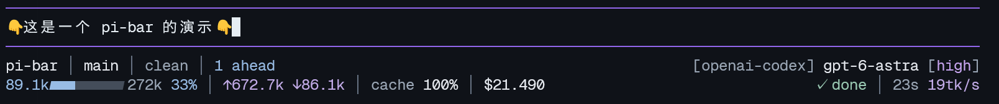

# pi-bar

给 [pi](https://pi.dev) 加上一块清晰的双行状态栏。当前分支、使用的模型、上下文用量和任务进度，都能在输入框下方一眼看到。



状态栏会跟随 pi 切换深浅配色。窗口变窄时，自动缩短名称、收起次要信息，始终保持两行。

## 安装

需要先安装 pi、Git 和 Node.js 22.18 或更新版本。目前已在 **pi 1.5.2** 上验证。

在终端执行：

```sh
pi install git:github.com/takkoury/pi-bar
```

然后重启 pi，或在 pi 空闲时输入 `/reload`，就能看到新的状态栏。

安装后对所有项目默认开启，不需要修改项目配置，也不用手动编译或安装字体。

## 显示哪些信息

### 目录与 Git 状态

第一行左侧显示目录名和 Git 分支，以及文件和提交的状态：

| 显示                                | 含义                                      |
| ----------------------------------- | ----------------------------------------- |
| `clean`                             | 没有未提交的改动                          |
| `modified` / `staged` / `untracked` | 已修改 / 已暂存 / 尚未加入 Git 的文件数量 |
| `conflicts`                         | 存在冲突的文件数量                        |
| `ahead` / `behind`                  | 相比跟踪分支，领先 / 落后的提交数量       |
| `synced`                            | 与跟踪分支没有提交差异                    |

Git 状态会自动刷新，也会定期获取远端分支信息。**不会自动提交、推送或改动你的代码。**

### 模型与 Thinking 等级

第一行右侧显示当前服务商、模型和思考等级，例如：

```text
[openai-codex] gpt-6-astra [high]
```

切换模型或思考等级后，状态栏会跟着更新。等级文字使用逐渐增强的紫色，方便辨认。

### 上下文、Token、缓存与费用

第二行左侧集中展示用量：

| 信息         | 含义                                           |
| ------------ | ---------------------------------------------- |
| 上下文进度条 | 当前占用量、容量上限和占用百分比               |
| `↑` / `↓`    | 整个会话累计输入 / 输出的 Token 数量           |
| `cache`      | 最近一次主模型响应的输入中，来自缓存读取的比例 |
| `$`          | 整个会话的累计费用，以美元显示                 |

`k` 表示千，例如 `89.1k` 约为 89,100。上下文占用不是累计输入量；达到 70% 时变为琥珀色，达到 90% 时变为红色，提醒你留意剩余空间。压缩后暂时无法确定占用时，会显示 `?`。

费用来自服务商提供的数据或 pi 的估算，不一定与实际账单一致；没有价格数据时，也可能显示为零。

### 任务状态、耗时与速度

第二行右侧显示任务的当前状态：

- `working`：正在执行。
- `done`：已完成。
- `aborted`：已中止。
- `error`：出错结束。
- `idle`：暂无任务记录。

执行时，耗时显示为 `02:13`；结束后改为 `02m13s`。这个时间包含模型响应、工具执行和等待。

`tk/s` 表示每秒输出的 Token 数量。执行中显示最近一次已完成响应的速度，任务完成后显示本次任务的整体速度，不包含工具执行时间。数据不足时显示 `—`，中止或出错后不显示速度。

## 使用指令

在 pi 的输入框中输入：

| 指令       | 功能                            |
| ---------- | ------------------------------- |
| `/bar`     | 在开启和关闭之间切换            |
| `/bar on`  | 开启 pi-bar                     |
| `/bar off` | 关闭 pi-bar，恢复 pi 默认状态栏 |

默认开启。开关状态不会永久保存，重启或 `/reload` 后会重新开启。

## 更新与卸载

更新到最新版本：

```sh
pi update git:github.com/takkoury/pi-bar
```

不再需要时卸载：

```sh
pi remove git:github.com/takkoury/pi-bar
```

更新或卸载后，重启 pi，或在空闲时执行 `/reload` 即可生效。
